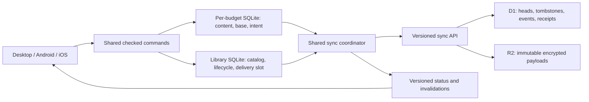

# Sync v2 — redesign specification

**Status:** proposed; accompanying implementation plan prepared; not implemented.  
**Baseline:** main `068a347`, reviewed 28 October 2026.  
**Companions:** [review and evidence](../reviews/2026-10-28-sync-review.md), [implementation plan](2026-10-28-sync-v2-implementation-plan.md).

Implementation may begin only after the user authorizes it. This document chooses recommended defaults so execution does not depend on repeated product questions. Changes to these defaults should be recorded before their work package starts.

## 1. Product contract

Enable Sync once for an account. From then on, ordinary new budgets, incoming budgets, edits and deletions reconcile automatically. The ordinary library is the management surface. Account & sync manages sign-in, encryption, subscription, status and exceptional recovery.

| Situation | Intended behavior |
|---|---|
| New budget, fresh start or import-as-new | Account-associated automatically when account Sync is enabled; new identity. Explicit local-only and samples remain local. |
| New device after sign-in/unlock | Account library appears without creating a blank budget or visiting a download list. Download active budgets automatically, one at a time. |
| Existing unassociated local budgets | One-time batch association screen; keep local unless selected. Never infer identity from names or similar content. |
| Open remote-only budget | Download, validate, atomically publish locally, then open. Other library operations remain usable. |
| Remove download | Device-local eviction; retain metadata and a persistent eviction preference. Open downloads it again. |
| Move account budget to Trash | Durable synchronized deletion; hide locally immediately after recording intent, including offline. |
| Move local-only budget to Trash | Local durable deletion; no cloud call. |
| Restore | Explicit lifecycle operation, retaining logical identity but establishing a new incarnation. |
| Remote deletion with local edits/draft | Preserve recovery, disable writes to the deleted identity, show the library and offer Recover as a copy. Never silently undelete. |
| Delete the active/last budget | Close it into the library. An empty library is valid and stays empty after restart. |
| Sign out / sign into another account | Preserve owner binding and queued work. Account A's budget never uploads to B. Cached A budgets remain labeled and editable offline, with A's sync paused. |
| Create after explicit sign-out | New budgets are local-only and stay so after sign-in unless explicitly associated. An account still selected but offline, locked, expired or awaiting reauthentication retains ownership for new budgets and queues work. |
| Restore a content backup into a live budget | New local edit of that budget; preserve live sync identity and ancestry. Importing a backup as a new budget never inherits them. |

**Recommended defaults:** 30-day recoverable cloud trash; compact deletion fences retained beyond that; two-second outbound batching with a maximum 15-second delay under continuous edits; 30-second foreground catalog polling with jitter plus immediate startup/foreground/reconnect triggers; three-second best-effort desktop exit drain after durable local save. These are targets, not network/background delivery guarantees.

No automatic expiration of recovery copies containing unacknowledged edits. No automatic account transfer. Do not add shared/multi-user budgets, an always-running desktop service, push infrastructure, delta blob transfer or a full CRDT rewrite to this project.

## 2. Invariants

These are acceptance criteria, not implementation suggestions.

1. Every write is bound to a stable account ID, key generation, remote budget ID and incarnation. Credentials and email addresses do not define ancestry.
2. A server head version is never reused. Trash/restore cannot make an old write valid again.
3. Unknown upload outcome is resolved before the client publishes or merges that same change again.
4. A successful local save survives process death without relying on a frontend timer/event.
5. A local merge and its new base/pending-upload state commit together in one budget database transaction.
6. No claim of atomicity spans separate SQLite files, SQLite and filesystem rename, or D1 and R2. Each boundary has a replayable durable journal.
7. Receiving a deletion never causes an old local budget to recreate its remote identity.
8. Eviction, explicit deletion, missing files and an empty catalog response are distinct states.
9. Sync never discards crash recovery, an open form draft, unknown budget fields or unacknowledged edits.
10. A conflict answer applies only to the values/revisions the user reviewed.
11. Money-move groups are never partially merged.
12. “Synced” means the relevant saved local revision is acknowledged and there is no pending work/conflict for that budget.
13. Refresh/invalidation identifies budgets and versions; a later network failure cannot hide a successful local change.
14. Legacy writers are rejected at commit after migration, including requests started before activation.
15. Retrying any create/update/trash/restore/ack step is idempotent.

## 3. Architecture

Keep encrypted whole-budget snapshots, existing domain validation, unknown-field preservation and ordinary three-way record merging.

Frontends issue commands, render library/status snapshots and send wake signals. They do not own correctness, upload queues, ancestry or the only sync timer.

The coordinator works with **zero open budgets**. Network work never holds the library/Store mutexes or a SQLite write transaction. Read immutable snapshots, release locks, perform IO, then revalidate identity/version before committing.

### Identity and wire types

- `accountId`: authenticated server user ID, retained locally across sign-out.
- `keyGeneration`: encryption reset generation, separate from protocol version.
- `catalogEpoch`: invalidates incompatible catalog/cursor histories.
- `localBudgetId`: device-local UUID, independent of remote ID and filesystem path.
- `budgetId`: stable remote logical ID within its account.
- `incarnation`: fresh opaque ID on create and every restore.
- `version`: monotonically increasing head version for this budget across create/update/trash/restore.
- `installationId`: random identity for one account + local installation, not the device name.
- `sequence`: monotonically increasing installation mutation sequence.
- `operationId`: local immutable intent ID; mapped to one installation sequence when dispatched.
- `localRevision`: saved content revision; separate from a remote head version.

Encode potentially 64-bit versions/sequences as validated decimal strings in JSON. Use unambiguous canonical manifest serialization for request digests. The same budget ID on two different accounts is never a match.

## 4. Local persistence

### Authoritative library database

Replace cached whole-file `budgets.json` mutation with `library.sqlite3`. Minimum logical tables:

| Table | Required contents |
|---|---|
| `app_state` | Local storage version, initialization/legacy-import completion, optional active localBudgetId, library version |
| `local_budgets` | localBudgetId, relative folder, optional owner/remote binding, lifecycle state, availability, eviction preference, cached name/currency, last-opened |
| `account_catalog` | Account/key/epoch, remote identity/head version/state, encrypted/decrypted local metadata, remote deletion/restoration information |
| `account_sync` | Stable account identity, protocol mode, cursor/highwater, installation identity, next sequence, pause/last-success state |
| `lifecycle_jobs` | Durable create/adopt/download/evict/trash/restore/recover/migration steps, paths/checksums and completion markers |
| `delivery_slot` | At most one dispatched mutation per account+installation, its sequence and immutable per-budget/lifecycle intent reference, receipt, completion phase |
| `sync_hints` | Rebuildable dirty/status/index hints; never the sole evidence that a budget needs upload |

Use fresh transactional reads and unique constraints, including at most one local binding for a given account/remote ID. Local library selection updates one row; it must not rewrite a cached catalog. Maintain a monotonically increasing library version for UI invalidation.

### Per-budget authoritative state

Financial content remains in its existing SQLite file. Add:

- `sync_binding`: account/key/catalog identity, remote ID/incarnation, acknowledged remote version, acknowledged local revision, trusted base snapshot/hash and provenance.
- `sync_upload`: immutable intent ID, expected identity/version, candidate base, captured local revision, exact sealed payload/metadata bytes and digest, state and accepted receipt.
- Durable dirty/recovery state written with **every** persisted budget mutation, including imports, assistant edits, undo/redo, schedules, native patch saves and content restore.
- Durable financial-editor draft checkpoints containing editor epoch, target identity, original baseline and raw/partially valid values. These are recovery data, not validated financial records. A live editor registers before accepting input and checkpoints as it changes. Login codes, passphrases, tokens and other credential-form inputs are excluded.

A save while an upload is pending may change live content but cannot rewrite that upload's bytes or candidate base. After its acknowledgement, newer edits remain dirty.

Do not store credentials or the encryption key in these tables. Ordinary portable backups/exports contain budget content, not installation identity, delivery slots or account binding. A full filesystem rollback/clone is a separate recovery condition.

### Cross-file recovery protocol

For new/downloaded/restored budgets:

1. Commit a lifecycle staging row and reserved identity/path in the library.
2. Write/validate a staging budget DB and flush it; preserve any old complete copy.
3. Publish the complete file and completion marker.
4. Commit the library entry/availability and clear the staging state.
5. On restart, inspect markers and checksums to finish or quarantine each interrupted step.

For an upload acknowledgement:

1. Keep the global delivery slot occupied.
2. For accepted content publication, commit candidate base + acknowledged captured revision + receipt marker in the budget DB without replacing newer local content. Rejection/cancellation/expiry records the receipt but does **not** advance the base or acknowledged content revision; edits remain dirty. Accepted lifecycle/control receipts update their corresponding lifecycle state instead of acknowledging a content snapshot.
3. Mark that slot completed and advance the local installation sequence in the library DB.
4. Recovery uses the per-budget receipt marker to replay step 3. Never allocate the next sequence while step 2 is uncertain.

For trash/eviction, record intent before moving/deleting files. A database with unresolved upload intent is pinned until its outcome is settled or the complete journal is safely preserved. Logical trash may precede physical cleanup. Delete only validated managed paths after closing Store handles and preserving drafts. A missing file becomes “Unavailable locally”, not cloud deletion.

On remote deletion, persist the tombstone immediately and reject further financial commits to that identity. Before clearing a live editor/view, durably acknowledge its latest draft checkpoint, then close/archive it. On process death recover the last durable checkpoint and saved budget. Do not promise recovery of keystrokes never durably written before an unrelated sudden crash. Test death after tombstone receipt but before the UI callback, including incomplete/invalid form values.

Document a single lock order: coordinator/account operation lock → library/active-store coordination → budget Store lock. Do not invert it from sign-out or UI callbacks. Keep database transactions short; use durable job states across separately locked phases.

## 5. Server storage and protocol

Keep existing v1 data while adding separate v2 tables. Proposed minimum:

| Table | Purpose |
|---|---|
| `sync_accounts_v2` | Protocol state, catalog epoch/highwater/min retained cursor, v2-owned key generation/salt/check, migration state |
| `sync_heads_v2` | Account+budget primary key; incarnation, monotonic version, active/trashed/purged state, object reference, payload format, encrypted metadata, size, deletion/retention timestamps |
| `sync_events_v2` | Immutable catalog event at a unique account sequence, with identity/version/state; finite retention |
| `sync_installations_v2` | Installation status, last terminal sequence, canonical digest and last immutable receipt/result; retained sequence fence |
| `sync_staging_v2` | Reserved mutation manifest, installation/sequence, generation, blob key/hash/size, upload/lease/expiry/publication state |
| Shared object garbage queue | Reclaim only objects unreferenced by any legacy head, v2 head/trash retention or live staging job |

Keep compact head/tombstone identity and version rows after ciphertext expiry. Do not reuse an old remote ID through the create endpoint. Never TTL-delete an installation fence and allow that ID to register afresh.

### API contract

All routes below are proposed under `/api/v2/sync`; authenticated account identity comes from the session, never a trusted body field.

| Endpoint | Contract |
|---|---|
| `GET /bootstrap` | Account ID, key generation/check, protocol/capabilities, catalog epoch, entitlement and migration state |
| `POST /installations` | Register a new random installation ID or recover its existing status; retired IDs cannot reset sequences |
| `GET /catalog/snapshot` | Consistent bounded active-head snapshot + highwater/epoch |
| `GET /catalog/changes?after=&through=` | Immutable ordered changes after cursor through a frozen highwater, paginated |
| `POST /budgets/status` | Batched authoritative status of known IDs, including compact tombstones |
| `GET /budgets/{id}/content` | Content for a checked identity/version; return actual identity/version with bytes; version race is retryable |
| `POST /mutations/{sequence}/prepare` | Reserve immutable canonical manifest; validate generation, installation sequence, identity, expected head, sizes and policy |
| `PUT /mutations/{sequence}/blob` | Bounded raw encrypted payload for reserved create/update/restore operation; verify declared hash and size |
| `POST /mutations/{sequence}/commit` | Atomically decide/publish or reject, record terminal receipt, advance installation sequence and append event |
| `POST /mutations/{sequence}/cancel` | Terminal cancellation only if uncommitted; a committed mutation returns its existing receipt |
| `GET /installations/{id}/receipt` | Recover last terminal sequence/digest/result, even after another installation advances the budget |
| `GET /trash` | Paginated recoverable-trash UI data; deletion correctness uses status/feed, not completeness of this list |

Budget manifest: operation ID, kind (`create/update/trash/restore/purge`), key generation/epoch, budget ID/incarnation, expected version, proposed create/restore incarnation, optional encrypted metadata, payload format/hash/length. Restore also identifies its retained source payload version/context. Exact normalized manifest plus ciphertext hash determines request identity. Persist the bytes locally; retrying cannot generate a new nonce/ciphertext under the same sequence.

Trash/purge carry no replacement payload. Every v2 restore requires an unlocked client to download/decrypt retained content and re-seal it for the new incarnation, operation and parent version. Download returns the original authenticated payload context, which can differ from the current tombstone version. The server checks source lineage and the new ciphertext hash; E2EE prevents it from verifying plaintext equality. The client enforces restore-from-retained-content, sending subsequent edits separately. A permanently purged payload cannot be restored; recover a local copy under a new budget ID instead.

Account-control manifests use the same sequence/receipt machinery with kinds `keySetup/keyReset/migrateProtocol`, no budget ID, an expected nullable/current generation and protocol, and the proposed salt/check where relevant. Receipts return resulting generation/epoch/protocol. Bootstrap/installation registration works before a key exists. Migration is available through the compatibility server before activation; setup/reset/activation are account-CAS transactions with their own application markers. Never perform an unreceipted side-channel reset.

Prepare success is not publication. Only the terminal commit receipt makes a change authoritative. Transient server/network failure leaves the outcome unresolved.

A well-formed next-sequence manifest rejected at prepare for a stale head/generation or policy receives a stored terminal rejection receipt. Authentication, malformed input and transient failures before reservation do not consume a sequence; retain it until retry or explicit cancellation of that digest. Cancellation can settle an authenticated next sequence even when prepare never reserved it. Staging expiry cannot free a sequence for another digest: it atomically produces a terminal expired receipt, and late uploads under that request cannot publish.

### Bounded idempotency receipts

Allow **one globally outstanding mutation per account+installation**, across all its budgets.

- Sequence = last + 1: eligible for a new terminal decision.
- Sequence = last with identical digest: return the original receipt before checking current budget preconditions.
- Same sequence with different digest: reject operation reuse.
- Sequence < last: reject stale local state; never reapply.
- Sequence > last + 1: reject a sequence gap.
- Re-registering an old/revoked installation ID cannot reset its counter.

The server retains the last result per installation indefinitely within its identity generation. This is sufficient because a conforming client cannot advance until it durably acknowledges that result. Other devices advancing/deleting/restoring the budget do not overwrite this installation's receipt.

A terminal conflict consumes a sequence and retains its rejection receipt; after acknowledging it, the client fetches/reconciles and allocates a new sequence. Temporary transport failures and a missing response do not authorize a new operation. Pending cancellation also returns a terminal receipt.

If a backup/clone presents an older sequence, quarantine any intent whose outcome is no longer provable from the bounded receipt. A fresh installation ID alone cannot make it safe: it may have been accepted and then deleted elsewhere. Require reviewed recover-as-copy or replacement for ambiguous work; never silently replay it under a fresh sequence. Built-in content restore excludes installation/outbox state; inconsistent raw filesystem restores require integrity/reconciliation checks rather than a claimed cross-file snapshot guarantee.

### Publication transaction and R2

D1 decides ordering; R2 stores immutable objects. Stage the manifest durably **before** uploading. Never claim D1+R2 atomicity.

At commit, one conditional D1 transaction must establish all of:

1. Still-valid account/protocol/key generation and installation sequence.
2. Exact staged digest/blob readiness and expected head state/version/incarnation.
3. Entitlement and atomic active-count/byte quota checks.
4. One terminal decision/receipt, installation sequence advancement, any new head, catalog highwater/event and superseded-object garbage eligibility.

Use D1 transactional batches/conditional SQL or a carefully tested transaction-guard schema; do not implement a read-await-write sequence and call it atomic. The successful head-CAS statement itself writes its application marker (installation/sequence). All success-only event/object steps test that marker; owning the attempt claim alone does not prove the head changed. Reset/activation uses an equivalent account-CAS marker. A duplicate/failed-claim request emits no extra event and cannot advance again. The first terminal CAS/policy rejection advances the installation sequence exactly once with its rejection receipt, without advancing the catalog or adopting an object.

After commit, acknowledge the immutable receipt. On uncertain database outcome, query the receipt/head before cleanup. GC must recheck **all** reference types. Staging leases and publication eligibility must be fenced; periodic orphan inventory handles late R2 puts after a handler/lease expires. Do not delete a garbage record merely because an object was absent before a late writer finishes.

Cloudflare documents D1 batches as transactions and R2 as strongly consistent storage; neither provides a transaction across both services. See [D1 database batch](https://developers.cloudflare.com/d1/worker-api/d1-database/), [R2 consistency](https://developers.cloudflare.com/r2/reference/consistency/). Use checksum-bound/conditional R2 writes as documented in the [Workers API](https://developers.cloudflare.com/r2/api/workers/workers-api-reference/). A client-side timeout does not cancel an underlying D1 write; recover its receipt before interpreting the outcome. [D1 debugging and timeouts](https://developers.cloudflare.com/d1/observability/debug-d1/).

## 6. Catalog reconciliation

Avoid an unbounded full scan of tombstones and avoid paginating mutable heads as if they were an immutable snapshot.

1. Obtain the active snapshot (current product limit: 50 active budgets) and highwater from one consistent D1 read/batch.
2. For each already-bound local ID absent from the active snapshot, request authoritative status. Distinguish trashed/purged, moved generation and unknown/anomalous ID.
3. Persist snapshot/status observations and download jobs locally before advancing the applied catalog cursor.
4. Replay immutable events after that highwater. Freeze `through` for each paged catch-up.
5. Apply head observations monotonically; ignore a replayed older version already superseded by a newer authoritative status lookup.
6. On expired cursor, repeat snapshot + known-ID status reconciliation. Never equate “cursor expired” or “not listed” with permission to upload.
7. New metadata can be acknowledged before payload download: persist a download-needed state so download failure remains retryable.
8. Explicit eviction suppresses automatic download but never suppresses deletion/status updates.

Events may expire after 30 days. Compact tombstones/version fences do not expire with events or encrypted trash. A catalog epoch change forces bootstrap; key-generation change also locks content processing until the correct key is available.

## 7. Reconciliation algorithm

On any wake:

1. Capture account/session identity; acquire coordinator operation ownership.
2. Repair incomplete local lifecycle/delivery jobs.
3. Resolve the outstanding installation receipt/uncertain operation first. No new upload/rebase of that intent until resolved.
4. Bootstrap identity/key/protocol, then reconcile catalog and deletions.
5. Process active-budget download and dirty work first, then other budgets fairly. A conflict in one budget does not starve others.
6. For a trusted same-incarnation base: unchanged/unchanged → nothing; local-only change → prepare upload; remote-only change → checked local save/base; both changed → merge/validate, then atomically save merged content + remote base + immutable pending intent.
7. For absent/untrusted ancestry, preserve both copies for explicit reconciliation. For an authoritative restored incarnation, a fully acknowledged clean old copy with no draft/unresolved intent automatically hydrates and rebinds. Dirty/recovery/ambiguous old copies are quarantined first, never merged across incarnations. Recovered copies retain provenance but no live remote binding, avoiding the unique account/budget constraint. Never silently union deleted records.
8. Drain eligible pending work; persist errors/backoff and emit identity-specific state changes.

Resolve an accepted old intent using its exact captured snapshot as the acknowledged base, then merge later remote heads against that base. This is the essential repair for the lost-ack double-assignment failure.

Use server preconditions again at commit; list/download observations are not locks. Recheck local revision/session/budget identity after network IO. Bounded retries may continue a pass after a race; repeated contention yields pending state and backoff, not a tight loop.

## 8. Monetary and editor semantics

### Assignments: conservative complete v2 policy

Treat each month's **entire assignment vector, assignment extras and associated money-move history** as one three-way conflict domain.

- One side unchanged: take the changed side.
- Entire resulting blocks identical: take once.
- Both changed differently: present one month-level conflict, showing category deltas and total effects; apply a whole coherent chosen block.
- Different months still merge automatically.
- Ordinary transactions/category metadata retain field-level merging.
- Never merge that month's move history again independently after resolving the block.

This deliberately increases prompts for simultaneous edits in the same month's planning. It is preferable to silently inventing or dropping allocations. Routine sync remains automatic; this affects genuine concurrent planning edits.

Unrecognized legacy movement entries remain in an opaque preserved/conflicted bucket. Do not guess their month or discard them to make the grouping fit.

An operation-aware SetAssigned/MoveAssigned model is a later project. Today's logs are mutable, sometimes coalesced and not emitted by every write path; they are not an authoritative operation stream. Do not claim both perfect intent-preserving arithmetic and automatic snapshot-only merges.

### Editor commits

Command envelope: target localBudgetId + binding incarnation + editor epoch + original record/field values + intended changes. Whole-budget token is an additional guard, not a substitute for original values.

Merge unrelated received fields without erasing drafts; reject same-field changes or a deleted original. Revalidate dependencies such as account/category existence and monetary transaction groups. Preserve input when showing a conflict.

Conflict-resolution requests include reviewed local/base/remote identity and input fingerprints. Recompute on current snapshots; reuse only answers whose inputs remain identical. Never reuse wildcard/field-key answers against unseen changed values.

As immediate containment, desktop pauses application to a budget with pending recovery/open unsafe editors. The final checked-command model allows safe incoming changes while editors remain open.

## 9. Deletion, restore, retention and quotas

Lifecycle: `active → trashed → restored(active,new incarnation)` or `trashed → purged`. Head version increases at each transition. Purged identity remains fenced.

- Trash requires the reviewed head version/incarnation. If another device changed it, preserve local deletion intent but show the newer change for a decision; do not auto-retry destructive deletion against an unseen head.
- A remote tombstone wins over stale ordinary updates. Local unpublished edits become recovery, not resurrection.
- Restore requires the current tombstone and retained bytes; concurrent restores resolve via CAS/receipt.
- Eviction is local availability only, permitted after all saved work is acknowledged and no recovery/conflict, uncommitted editor input, import/assistant mutation, queued content operation or unresolved delivery remains. Safely checkpoint/close editors or defer eviction. Active/last eviction transitions to the no-open library state without deleting the remote budget or creating a placeholder.
- Trash retention: 30 days of ciphertext. Compact tombstones remain. Recovery drafts and recovered local copies do not auto-expire.
- Keep current 50-active-budget and 1-GiB account limits initially; retained trash bytes count toward storage and are shown in usage. Offer explicit Empty Trash to free space. Do not silently destroy recoverable data to admit a new upload.
- Staging gets a separate bounded reservation/quota/TTL so uncommitted uploads cannot evade storage limits. Validate bytes again at publication.
- Account deletion removes active/trash/staging objects and receipts, with existing billing/account-deletion guards extended to v2.

Recommended subscription policy: new publication/restore pauses when entitlement expires; authentication-valid key access, receipt recovery, existing-data download/export and deletion remain available. This is an explicit product change from the current all-routes subscription middleware and must be covered by billing tests/documentation.

## 10. Encryption, unknown fields and resource limits

Retain Argon2id and authenticated encryption. V2 authenticated context includes format, account ID, key generation, budget ID/incarnation, operation ID and parent version; distinguish content and metadata contexts. Server-assigned resulting versions are checked against the mutation receipt; they are not known at encryption time.

Preserve legacy payload format/context during migration until an unlocked client rewrites it. Every head records its payload format/source context; never label old ciphertext as v2 and attempt decryption with new AAD.

Server request hashes cover ciphertext/manifest, never plaintext budget values. No names, amounts, passphrases, tokens or decrypted conflicts in telemetry. Store keys in the current vault; a locked/unavailable vault pauses work rather than clearing ancestry.

Preserve unknown domain fields and assignment extras. `sourceExport` remains intentionally local-heavy data; document that encrypted sync is not a replacement for a complete source/export backup.

Process one payload at a time initially. Validate compressed size, bounded decompression, schema, IDs and domain invariants before atomic adoption. Retain the last complete local copy on corruption, disk-full or unsupported schema. Profile current 512-MiB decompression ceiling and full-snapshot clone behavior on supported phones; it is a limit, not a memory-safety guarantee. Streaming/staged decoding and lower automatic-work memory budgets must fail safely without silently truncating a budget.

## 11. Platform lifecycle and status

Shared coordinator owns pending work; UI timers and native schedulers wake it.

- Desktop: wake after durable save; on close/update flush local state first, attempt up to roughly three seconds of cloud drain, then exit safely with pending state. No indefinite network-dependent close.
- Android: application-scoped coordination and unique network-constrained WorkManager work. Activity destruction must not erase the queue; worker and UI share the same installation lock.
- iOS: foreground actor plus limited UIKit background execution to finish outstanding work; BGTaskScheduler for later best-effort retry. Expiration checkpoints state and stops safely.
- Every platform retries on foreground/unlock/reconnect. Polling is fallback; signing in/unlocking and receiving catalog data do not require an open budget.
- Do not weaken Keychain/vault access policy to force background sync. Validate locked-device behavior; defer if credentials are unavailable.

Android's persistent-work facilities are designed to survive app exits/restarts, subject to constraints; Apple's scheduler decides when background tasks run. Delivery while the app is terminated is therefore best effort, not a fixed-time guarantee. [Android WorkManager](https://developer.android.com/develop/background-work/background-tasks/persistent?hl=en), [Apple background strategies](https://developer.apple.com/documentation/backgroundtasks/choosing-background-strategies-for-your-app).

Return persistent status per account and budget, plus changed budget IDs/local revisions and library/status versions. Frontends reconcile these after missed events. Use Saved on this device, Waiting, Syncing, Synced, Available online, Download removed, Needs attention, In Trash and Deletion waiting. Keep last successful acknowledgement separate from last attempted network request. Never reduce an entire pass to a misleading green “ok”.

## 12. Migration, compatibility and rollback

### Local migration

Separate local SQLite schema version from financial budget schema. Migrate the JSON library once into transactional rows, preserving IDs, paths, recovery, backups and missing-file records. Persist legacy-import completion separately; an empty library must never reimport Android's old JSON file.

Require old processes to stop before migration. Fence old SQL writers with a higher database version and a per-connection storage-protocol handshake enforced by write triggers; test already-prepared old statements. The handshake is a compatibility fence, not a security boundary.

SQL fencing cannot stop an old process's filesystem rename/delete. Put migrated live data in `data/v2/budgets/<localId>/`, outside directories referenced by legacy registry entries. Preserve/refuse-write legacy source databases as recovery/sentinels; keep a durable migration manifest. New clients ignore later v1 registry rewrites. Never delete originals until verified backups and the migration recovery policy permit it.

### Server/account activation

1. Deploy additive v2 schema and a v1-aware compatibility server first; default accounts remain v1.
2. Ship compatible clients on desktop, Android and iOS before enabling ordinary account migration.
3. The first v2 activation explicitly explains older clients will need updating. Capture backups and authenticated ownership evidence.
4. In one D1 transaction: CAS expected protocol/key generation, seed v2 active heads with new incarnations and legacy payload contexts, initialize epoch/feed, and durably mark account protocol v2.
5. Fence legacy budget/key writes at D1 commit too. A v1 request already past middleware, including reset of an empty budget set, must not commit after activation. Account-deletion cleanup gets an explicit safe path.
6. Do not rotate encryption keys merely to change protocol. Existing data remains decryptable.
7. Reconcile local copies. Previously tracked same-account ancestry is reused only when its provenance can be validated. Missing/ambiguous legacy history is preserved and reviewed; do not invent a base.
8. Offer one-time batch association for other local budgets. A legacy ID absent from the frozen cloud may have been removed; publishing it uses a new identity.

Per-account migration is resumable/idempotent. Server v2 state is authoritative if the client crashes after activation. Client and server migrations do not need to succeed in one cross-system transaction.

### Key reset

Keep protocol upgrade distinct from destructive encryption reset. Reset is a receipted account-control mutation: persist its pending new key in the vault before prepare, retain the old key until the result is known, and activate the new key locally only after acceptance. Reset increments key generation/catalog epoch and fences old **writes**, while authenticated old-generation receipt lookup remains available.

The reset transaction terminally invalidates other reserved old-generation mutations with `invalidated_generation` receipts, advancing only their reserved sequences once; completed receipts/highwaters remain. The resetting installation settles its own earlier delivery first. Clients acknowledge invalidation without advancing content bases, quarantine old dirty copies, then continue their installation sequence. Never discard unknown intent or reset counters merely because generation changed. Account deletion explicitly removes the account/receipts; retained local data cannot bind to a new account with the same email.

Explain that old remote-only encrypted data cannot be recovered without its key. Preserve old local copies and ancestry in quarantine; only explicitly selected active copies seed the new generation. Other devices unlocking the new key reconcile rather than automatically republishing every old/trash budget.

A non-destructive passphrase change via wrapped data keys is outside this implementation.

### Rollback and rollout gates

Before activation, compatible code can stay dormant behind flags. After activation, disabling v2 means **pause new work**, not downgrade to v1 or delete journals. Only deploy rollback builds that understand v2 schema/fences. Keep backups/snapshots and support export/recovery.

This repository automatically migrates/deploys Worker changes pushed to main. Implementation branches/PRs must keep activation disabled; production deployment and account enablement are explicit release steps. No production change is authorized by this planning document.

